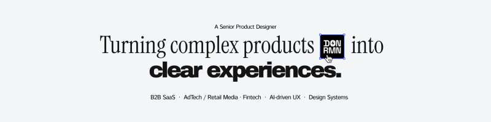

# Hi, I'm Ramon 👋

**Product Designer (11+ years) who builds with AI.**
I design products, then write the small agents and pipelines that remove the repetitive parts of my own work. Based in Valencia, Spain. Working remote in English, Spanish and Portuguese.

## What I build

| Project | What it does | Stack |
|---|---|---|
| [**job-hunt-agent**](https://github.com/ramonaguiar-wq/job-hunt-agent) | Hunts remote design jobs, ranks them against hard rules kept as data, drafts outreach. A human approves every message. | Python, Node, Claude CLI |
| [**video-edit-pipeline**](https://github.com/ramonaguiar-wq/video-edit-pipeline) | Raw clips to silence-trimmed preview and Premiere XML from a diffable JSON plan. Titles and cutaways anchor to spoken words. | Python, ffmpeg, Whisper |
| [**agent-orchestrator**](https://github.com/ramonaguiar-wq/agent-orchestrator) | Routes each task to Claude or Gemini from a JSON table, tracks token budgets and session health, falls back on failure. | Node.js, Claude CLI, Gemini API |
| [**design-system-tokens**](https://github.com/ramonaguiar-wq/design-system-tokens) | 87 semantic design tokens (JSON) documented from a dense, interactive analytics table. | JSON, React, Tailwind |

## How I work

- **Design decisions are written down.** Every repo has a case study: problem, constraint, decisions and why.
- **Humans stay in the loop.** My agents read, rank and draft. They never send anything in my name without a click.
- **Rules as data, not code.** Preferences live in files I can diff and test.

## Contact

- LinkedIn: [linkedin.com/in/ramonaguiar](https://www.linkedin.com/in/ramonaguiar)
- Portfolio: [studiodonramon.com](https://www.studiodonramon.com)
